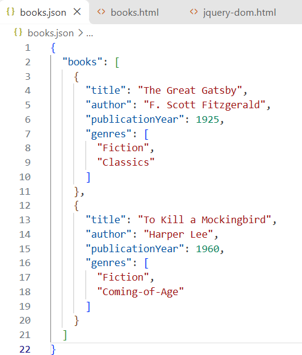
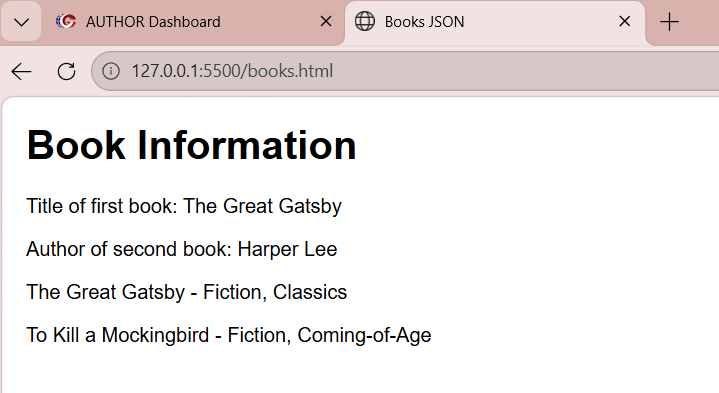
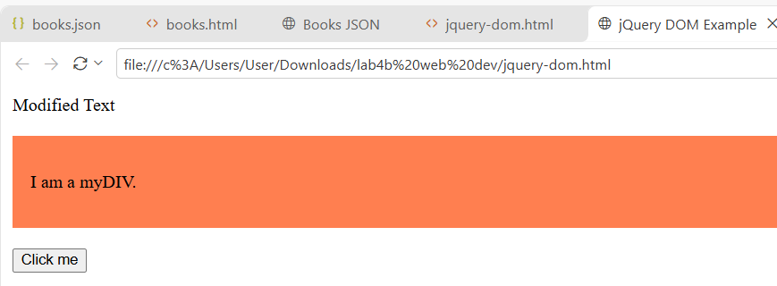
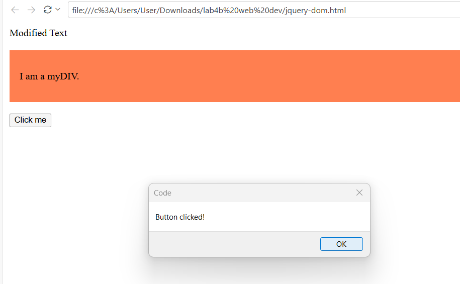

BIC 21203 Lab 4B CLIENT-SIDE SCRIPTING (JSON and jQuery)

NAME : ALYEA VANEESA ANAK JERMAN
MATRIC NUMBER : AI250106
SECTION : SECTION 2

QUESTION 1 :
JSON file containing book information

QUESTION 2 :
Fetch JSON data using JavaScript
Display book details
Error handling included

QUESTION 3 :
jQuery text manipulation
jQuery CSS class manipulation
jQuery click event handling

How To RUN :
1. Open the project in Visual Studio Code.
2. Install the Live Server extension.
3. Right-click books.html and select Open with Live Server.
4. Right-click jquery-dom.html and select Open with Live Server.

Screenshots
Question 1: JSON File

QUESTION 2 SCREENSHOT : Fetch API Output

QUESTION 3 SCREENSHOT : jQuery DOM Manipulation

GitHub Repository Link : https://github.com/jsmeee/lab4b-json-jquery
